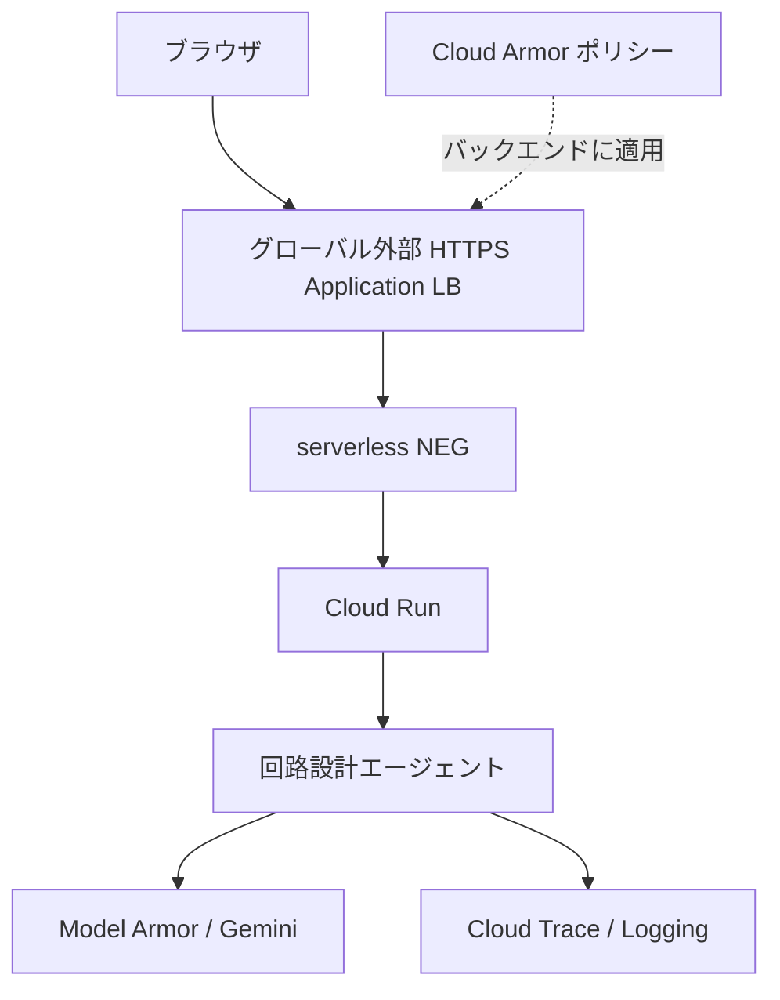

# Cloud Armor と HTTPS 公開入口

`make deploy` は Cloud Armor を常に有効にします。Cloud Armor（HTTPリクエストのWAF・流量制御）と Model Armor（AIの入力・生成結果の検査）は別のサービスです。



Cloud Run は `internal-and-cloud-load-balancing`、既定の `run.app` URL は無効です。インターネットから直接アクセスしてWAFを迂回する経路を閉じます。Cloud Run IAM は公開（`--allow-unauthenticated`）のまま必要です。LB自体はユーザー認証を行わないため、アプリの署名セッション・送信元検査・Firestore利用上限も維持します。内部通信を完全に拒否する設定ではありません。

## 初回準備

既存のCloud RunデプロイのAPI・IAM・Secret Manager準備に加え、管理できるDNSホスト名が必要です。

```bash
export GOOGLE_CLOUD_PROJECT=YOUR_PROJECT_ID
export REGION=asia-northeast1
export CLOUD_ARMOR_DOMAIN=breadberry.example.com
# 任意。これらの専用リソース名を他の用途と共有しないでください。
export SERVICE=breadberry
export EDGE_NAME=breadberry-edge

gcloud services enable compute.googleapis.com --project "$GOOGLE_CLOUD_PROJECT"
```

デプロイ実行者（Actionsなら `GCP_DEPLOY_SERVICE_ACCOUNT`）に `roles/compute.loadBalancerAdmin` と `roles/compute.securityAdmin` を追加します。API有効化は管理者が事前に行います。実行用サービスアカウントへのCompute権限追加は不要です。

```bash
export DEPLOY_ACCOUNT=breadberry-github-deploy@${GOOGLE_CLOUD_PROJECT}.iam.gserviceaccount.com
for ROLE in roles/compute.loadBalancerAdmin roles/compute.securityAdmin; do
  gcloud projects add-iam-policy-binding "$GOOGLE_CLOUD_PROJECT" \
    --member="serviceAccount:${DEPLOY_ACCOUNT}" --role="$ROLE"
done
make deploy
```

`make deploy` はビルド前にドメインを検査し、Cloud Runへデプロイ後、`scripts/setup-cloud-armor.sh` で固定IPv4・NEG・セキュリティポリシー・バックエンド・URLマップ・Google管理SSL証明書・HTTPSプロキシ・443転送ルールを作成します。既存の専用リソースは再利用し、管理対象ルールとポリシーの適用を再設定します。権限エラーはそのまま失敗させます。独立して入口だけを設定する場合は、既存サービスに対して `make cloud-armor` を実行できます。

表示された固定IPへDNSのAレコードを設定します。競合するAAAAレコードは削除してください。Google管理証明書が `ACTIVE` になるまでHTTPSは利用できません。初回はCloud Run直アクセスを閉じるため、DNS・証明書の準備が完了するまで公開アクセスが停止します。継続稼働が必要なら別の `SERVICE` / `EDGE_NAME` とホスト名で先行検証して切り替えてください。

`APP_ORIGIN` は `https://${CLOUD_ARMOR_DOMAIN}` に自動設定します。異なる値の指定はビルド前に拒否します。Actions Variablesの `CLOUD_ARMOR_DOMAIN` は必須、`EDGE_NAME` は任意です。既存の `APP_ORIGIN` 変数がrun.appを指している場合は削除するか新ドメインへ変更してください。旧公開URLへのリンクやハッカソン提出URLも変更します。

同じ `EDGE_NAME` のリージョン・サービス・証明書ドメインは固定とします。ホスト名やリージョンの移行には新しい `EDGE_NAME` を指定し、旧リソースの削除は別途行ってください。HTTP/80の入口とCloud CDNは作成しません。LB・Cloud Armor・IP・ログにはCloud Runと別の料金が発生します。

## 有効なルール

すべて `preview=false` です。番号が小さい順に検査します。

| 優先度     | 対象                     | 動作                      |
| ---------- | ------------------------ | ------------------------- |
| 1000       | `sqli-v33-stable`、感度1 | SQLi検出時403             |
| 1010       | `xss-v33-stable`、感度1  | XSS検出時403              |
| 2000       | `/api/` で始まるパス     | IPごと120件/60秒、超過429 |
| 2147483647 | その他                   | 許可                      |

JSON解析を有効にし、WAFの本文検査範囲は先頭64KBです。本文全体を無制限に検査するわけではありません。レート制限は近似的で、同じNATを共有する利用者は枠を共有します。静的3DモデルはAPIの流量枠に含めません。WAFの許可ルールをレート制限より先に追加すると制限を迂回できるため、この専用ポリシーはスクリプトで管理してください。WAFが回路のコードや入力を誤検出したらログを確認し、必要なシグネチャだけを除外する変更をレビューします。

## 導入後の確認

```bash
gcloud compute security-policies describe "$EDGE_NAME" --global --project "$GOOGLE_CLOUD_PROJECT"
gcloud compute backend-services describe "$EDGE_NAME" --global --project "$GOOGLE_CLOUD_PROJECT"
gcloud compute ssl-certificates describe "$EDGE_NAME" --global --project "$GOOGLE_CLOUD_PROJECT"
gcloud run services describe "$SERVICE" --region "$REGION" --project "$GOOGLE_CLOUD_PROJECT"
curl -i "https://${CLOUD_ARMOR_DOMAIN}/api/health"
# WAF拒否の確認用。403になることとLBログの適用ルールを確認します。
curl -i --get --data-urlencode 'probe=<script>alert(1)</script>' "https://${CLOUD_ARMOR_DOMAIN}/api/health"
```

ポリシーの `preview: false`、バックエンドの `securityPolicy`、証明書の `managed.status: ACTIVE`、Cloud Runのingressとdefault URL無効化を確認します。旧run.app URLへのインターネットからの要求がアプリへ届かないこと、ブラウザのセッション開始・回路生成・購入検索・NDJSON逐次表示が正常なことも確認します。非本番環境でAPIを120件/分より多く呼び、429と `rateLimitAction` を確認してください。

バックエンドのアクセスログはサンプル率1で有効です。Logs Explorerで `resource.type="http_load_balancer"` と `jsonPayload.enforcedSecurityPolicy.name` を確認します。Cloud Armorで拒否した要求はアプリのCloud Traceには現れません。Cloud Armorのログに入力内容を余分に記録するverbose loggingは設定しません。

## 公式資料

- [Cloud Run ingress](https://docs.cloud.google.com/run/docs/securing/ingress)
- [Cloud Armorとserverless NEG](https://docs.cloud.google.com/armor/docs/integrating-cloud-armor)
- [事前構成WAF](https://docs.cloud.google.com/armor/docs/waf-rules)
- [JSON本文解析](https://docs.cloud.google.com/armor/docs/content-parsing)
- [serverless NEGの制限](https://docs.cloud.google.com/load-balancing/docs/negs/serverless-neg-concepts)
