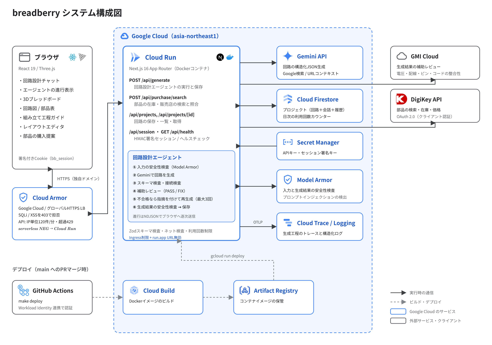
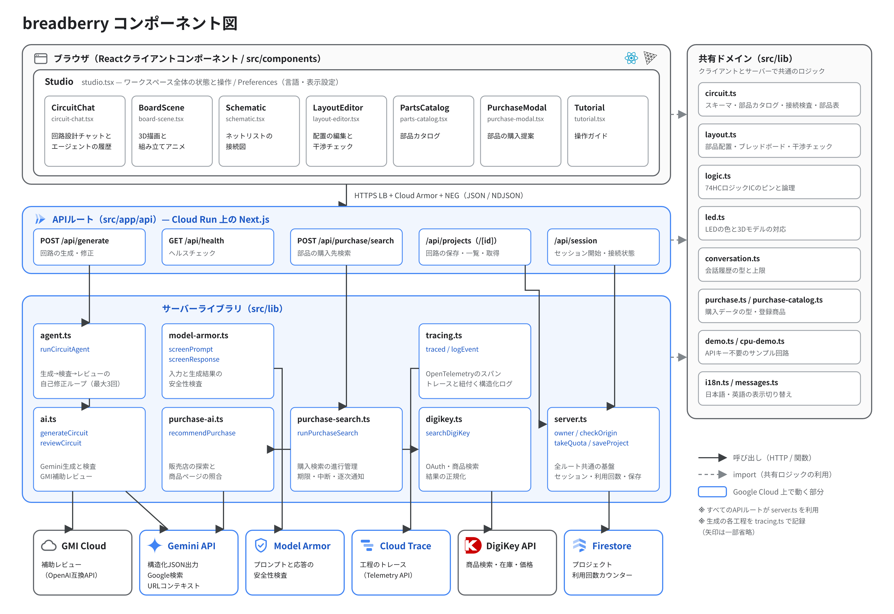
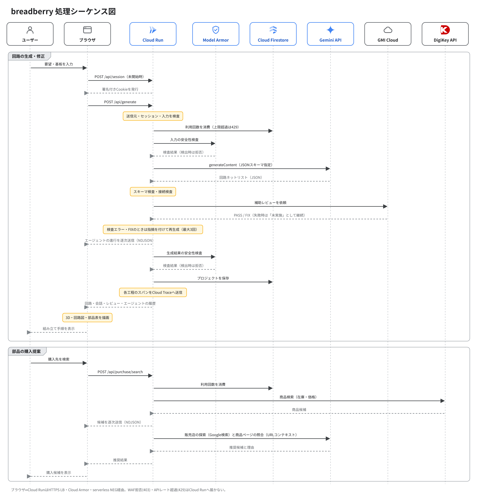

# Architecture

breadberry のシステム構成、API、データ構造の概要です。

## 全体構成

公開通信は ブラウザ → HTTPS Application Load Balancer（Cloud Armor適用）→ serverless NEG → Cloud Run の順です。Cloud Runは `internal-and-cloud-load-balancing`、run.app URLは無効です。WAFはSQLi/XSSを403で拒否し、APIはIPごと120件/分を超えると429になります。Cloud Armorで拒否した通信は回路設計エージェントに到達しません。

Cloud RunのNext.js APIは回路設計エージェント、購入検索、署名セッション、プロジェクト保存を提供します。Model Armorはエージェントの入力・生成結果を検査する別の層です。Firestore、Gemini、GMI Cloud、DigiKey、Cloud Trace / Loggingとの連携は継続します。[公開入口の構成・設定](../docs/cloud-armor.md)を参照してください。

## コンポーネント構成

## 処理シーケンス

## 設計の中核：単一の回路データ

部品表・穴番号・3D・接続図・工程ガイドはすべて同じ回路ネットリスト（`src/lib/circuit.ts` の `circuitSchema`）から決定的に導出します。AI が 3D 形状を自由に生成するのではなく、あらかじめ定義した部品形状をネットリストに沿って配置します。

### 生成パイプライン

`src/lib/agent.ts` の回路設計エージェント（`runCircuitAgent`）が、次の流れを制御します。

1. ユーザー入力（プロンプト＋基板、任意で `context: { circuit, messages }`）
2. Model Armor が入力を検査（プロンプトインジェクションなど。検出時は拒否）
3. Gemini API が構造化JSONで回路を出力（Zod スキーマで型検査）
4. ネット検査で危険・不正な接続を検出
5. GMI Cloud が電圧・配線・ピン番号・コードの整合性を補助レビューし、`PASS:` または `FIX:` で判定（取得できない場合は「未実施」として設計を保持）
6. 手順4の検査エラー、または手順5の `FIX:` があれば、その指摘を Gemini に渡して手順3からやり直す（`AGENT_MAX_ATTEMPTS`、既定3・最大3）。上限に達しても解消できない設計は保存しない
7. Model Armor が生成結果の文章（題名・説明・注意事項・コード）を検査
8. Firestore に保存し、クライアントへ応答（`messages` に今回の依頼と回路説明、`agentEvents` にエージェントの履歴を追加）

### 可観測性

- **Cloud Trace：** `src/lib/tracing.ts` が、1件の生成要求を1本のトレースとして記録します。安全性検査・Gemini 呼び出し・接続検査・補助レビューがそれぞれスパンになり、Gemini のスパンにはモデル名とトークン数が付きます。OpenTelemetry の OTLP で Telemetry API へ送信し、`CLOUD_TRACE=true` のときだけ有効です
- **Cloud Logging：** エージェントの各ステップ、Model Armor の検出・接続失敗、トレースの送信失敗を JSON で標準出力へ記録します
- **画面：** 応答の `agentEvents` を「エージェントが行ったこと」として表示します
- エージェントのログと応答に含まれる `traceId` は独自に発行した ID で、Cloud Trace のトレース ID とは別です

### 安全性検査

- `src/lib/model-armor.ts` が Model Armor のテンプレートを呼び出します。`MODEL_ARMOR_TEMPLATE` が未設定なら無効です
- `MODEL_ARMOR_MODE=inspect` では、検出を記録するだけで拒否しません
- Model Armor に接続できない場合は検査を省略して処理を続けます。型検査とネット検査は常に実行します
- 補助レビュアーの接続先は `AI_PROVIDER_ALLOWED_HOSTS` に列挙したホストに限定します

## API

### `POST /api/generate`

従来の `{ prompt, board }` に加え、任意の `context: { circuit, messages }` を受け取ります。`messages` は `{ role: "user" | "assistant", content: string }` の配列です。

- 入力サイズ（1〜2000文字）・会話（最大50往復）・修正元の回路を検査
- `Accept: application/x-ndjson` を付けると、エージェントの進行（`event`）、結果（`result`）、エラー（`error`）を1行ずつ逐次送信。付けない場合は従来どおり JSON を1回で返す
- 応答にエージェントの履歴 `agentEvents` と `traceId` を含む
- 生成結果も従来の接続検査を通してから保存
- 応答の `messages` に今回の依頼と生成された回路の説明を追加
- 生成要求は全体・個別の上限を Firestore トランザクションで消費。失敗した要求も利用回数に含まれます

## データモデル（Firestore）

| パス | 内容 |
| ---- | ---- |
| `users/{signed-session-id}/projects/{uuid}` | 保存プロジェクト（回路＋会話履歴＋エージェントの履歴） |
| `quotas/global-YYYY-MM-DD` | アプリ全体の日次利用回数 |
| `quotas/{session-id}-YYYY-MM-DD` | セッションごとの日次利用回数 |

- 生成回数カウンターには 7 日 TTL を適用できます（`firebase deploy --only firestore`）
- セキュリティルールはデータベース全体のクライアント直接アクセスを禁止します。サーバー SDK のアクセスは IAM で管理します

## 認証・セッション

- HMAC 署名付き HttpOnly Cookie（`bb_session`）で所有者を分離
- Cookie は 30 日で失効。ログインアカウント方式ではなく、別端末への引き継ぎ・期限後の復旧は未実装
- `SESSION_SECRET`（32文字以上）で署名。`timingSafeEqual` で検証
- ローカル・クラウドともにセッションは自動開始。旧 `APP_ACCESS_TOKEN` は使用しない
- `APP_ORIGIN` で許可する送信元を1つに制限（CSRF 対策）。ブラウザの送信元と一致しない操作は 403

## 主なモジュール

| ファイル | 役割 |
| -------- | ---- |
| `src/components/studio.tsx` | ワークスペースと各操作 |
| `src/components/board-scene.tsx` | 部品・基板・ジャンパ線の 3D 描画とアニメーション |
| `src/components/circuit-chat.tsx` | 回路設計チャット UI とエージェントの履歴表示 |
| `src/components/schematic.tsx` | ネットリストの接続図 |
| `src/lib/circuit.ts` | 共通スキーマ、ピン表、配置、部品表、接続検査 |
| `src/lib/agent.ts` | 生成・検査・レビューを繰り返す回路設計エージェント |
| `src/lib/ai.ts` | Gemini 生成と GMI 補助レビュー |
| `src/lib/model-armor.ts` | Model Armor による入力・生成結果の検査 |
| `src/lib/tracing.ts` | Cloud Trace へのトレース（OpenTelemetry）と構造化ログ |
| `src/lib/conversation.ts` | 会話コンテキストの型・制約 |
| `src/lib/demo.ts` | APIキー不要のサンプル回路 |
| `src/lib/server.ts` | セッション、Firestore、利用回数制限 |

## エラーハンドリングの方針

- AI サービスのタイムアウト・不正応答は `ServiceError` として適切な HTTP ステータスで返却
- 接続検査の不合格と補助レビューの `FIX:` は、エージェントが自動で再生成（最大3回）。上限に達した場合は 422 を返す
- 生成失敗時は回路・履歴・入力を保持して再試行可能
- Firestore 保存失敗時はブラウザ保存へ切り替えて明示（成功したと偽らない）
- Model Armor・Cloud Trace の障害や権限不足では生成を止めず、警告ログを記録
- 全体上限により、セッションを作り直しても無制限には生成できません
